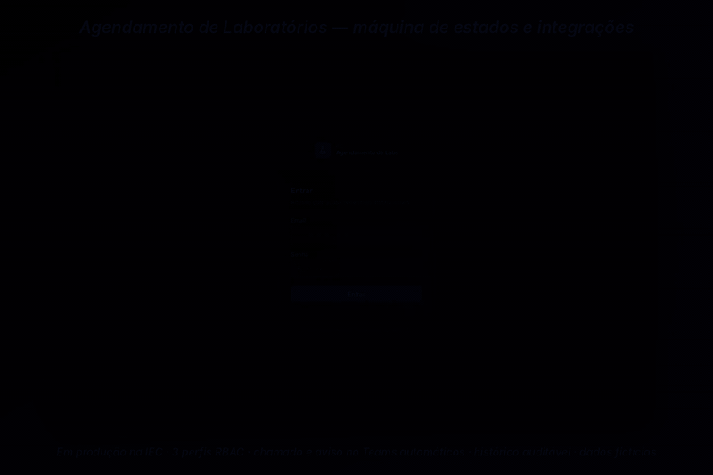

# LaboratoriosIEC — agendamento de laboratórios

**Sistema de reservas de laboratórios em produção no IEC/PUC Minas: máquina de estados, 3 perfis de acesso, chamado e aviso no Teams automáticos, evento na agenda do laboratório e histórico auditável de cada reserva.**

Esta é uma **cópia pública e sanitizada** do código que desenvolvi para o Instituto de Educação Continuada (IEC) da PUC Minas, publicada com histórico novo. Endpoints internos, credenciais, agendas reais, nomes e e-mails foram removidos ou trocados por dados fictícios.



<sub>Vídeo em MP4: [docs/media/laboratorios-demo.mp4](docs/media/laboratorios-demo.mp4)</sub>

## O problema

Reservar um laboratório envolve aprovação, controle de disponibilidade, abertura de chamado para a TI preparar as máquinas e aviso às equipes envolvidas. O sistema concentra esse fluxo num lugar só, com o estado de cada pedido visível para quem pede e para quem aprova.

## Como funciona

```
Apoio acadêmico ──► nova reserva (várias datas)
                     │  status: AGUARDANDO_CONFIRMACAO
                     │  presencial? ──► abre chamado na API de chamados (CSC) ──► aviso no Teams (webhook)
                     ▼
Operador de TI ───► confirma com laboratório ──► CONFIRMADA ──► evento na agenda do laboratório (Google Calendar)
                 ├─► marca conflito de datas ──► CONFLITO_DE_DATAS ──► apoio propõe novas datas ──► volta para análise
                 └─► rejeita com motivo ──────► REJEITADA
```

| Perfil | Pode |
|---|---|
| `APOIO_ACADEMICO` | Criar e acompanhar as próprias reservas, corrigir datas em conflito |
| `OPERADOR_TI` | Confirmar, rejeitar, marcar conflito, ver integrações |
| `ADMINISTRADOR` | Tudo, mais cadastros e usuários |

Páginas: dashboard com agenda semanal, kanban por status, lista e detalhe da reserva (com linha do tempo), calendário por laboratório, cadastros (laboratórios, professores, turmas, usuários) e logs de integração.

## Decisões de arquitetura

- **Máquina de estados explícita.** As transições válidas ficam declaradas em `src/types/index.ts` (`transicoesValidas`) e são checadas no serviço; `CONFIRMADA` e `REJEITADA` são finais. Testes em `src/tests/reserva-state-machine.test.ts`.
- **Integrações condicionais e desacopladas.** Chamado e aviso no Teams só para reservas presenciais, disparados depois da gravação, sem bloquear a resposta ao usuário. Toda chamada externa vira um registro em `LogIntegracao` (sucesso ou erro) — a tela *Integrações* mostra o que aconteceu.
- **Agenda por laboratório.** Cada laboratório pode ter um `googleCalendarId`; a confirmação cria o evento, o reagendamento atualiza e a rejeição remove. Sem agenda vinculada, a etapa é pulada com aviso.
- **Horários em tabela própria.** `DataHorarioReserva` guarda `dia`, `horaInicio` e `horaFim` (e o `googleEventId` de cada data), em vez de pares de `DateTime` — conflito e reagendamento passam a ser por data.
- **Histórico auditável.** Cada mudança de status, envio ao CSC, aviso no Teams e evento na agenda vira uma linha em `HistoricoTramitacao`, com quem fez e quando.
- **Banco só por migrations.** O schema evolui apenas por `prisma/migrations`.

## Resultado

Em produção no IEC/PUC Minas (números de uso ainda não publicados). Desenvolvido de forma AI-first, com spec como contexto para os agentes de código e revisão humana de cada entrega.

> Esta cópia corresponde a um snapshot do código. As páginas de auditoria e relatórios (Recharts) e o processo de ELT (SharePoint + agendas do Google) da versão em produção não fazem parte dela.

## Stack

Next.js (App Router) · React · TypeScript · Prisma · PostgreSQL/Supabase · NextAuth (credentials + bcrypt, JWT) · TanStack Query · Tailwind CSS · Zod · Jest

## Como rodar

```bash
npm install
cp .env.example .env.local      # preencha DATABASE_URL e NEXTAUTH_SECRET; integrações são opcionais
npm run db:migrate
npm run db:seed                 # dados 100% fictícios
npm run dev
```

Acesso do seed (senha `Demo@1234`): `admin@exemplo.com`, `operador@exemplo.com`, `apoio@exemplo.com`.

Sem as variáveis do CSC e do Teams, as tentativas de integração ficam registradas como erro em *Integrações* e o fluxo de reservas continua funcionando.

### Testes

```bash
npm test
```

`reserva-state-machine` e `integracao.service` passam. As três suítes ligadas ao Google Calendar (`google-calendar.service`, `reserva-integracao` e `reserva-conflito`) foram escritas antes de a agenda passar a ter um evento por data (`DataHorarioReserva`) e precisam ser atualizadas — está na lista de pendências.

## Dados e segurança

- Nenhum dado real: usuários, professores, turmas, laboratórios e agendas do seed são fictícios.
- Nenhum endpoint interno: as URLs da API de chamados e do webhook do Teams ficam só em variáveis de ambiente.
- `.env*` fora do versionamento; credenciais nunca vão para o repositório.

---

Feito por [Felipe Sobrinho](https://felipe-nephew.vercel.app)
